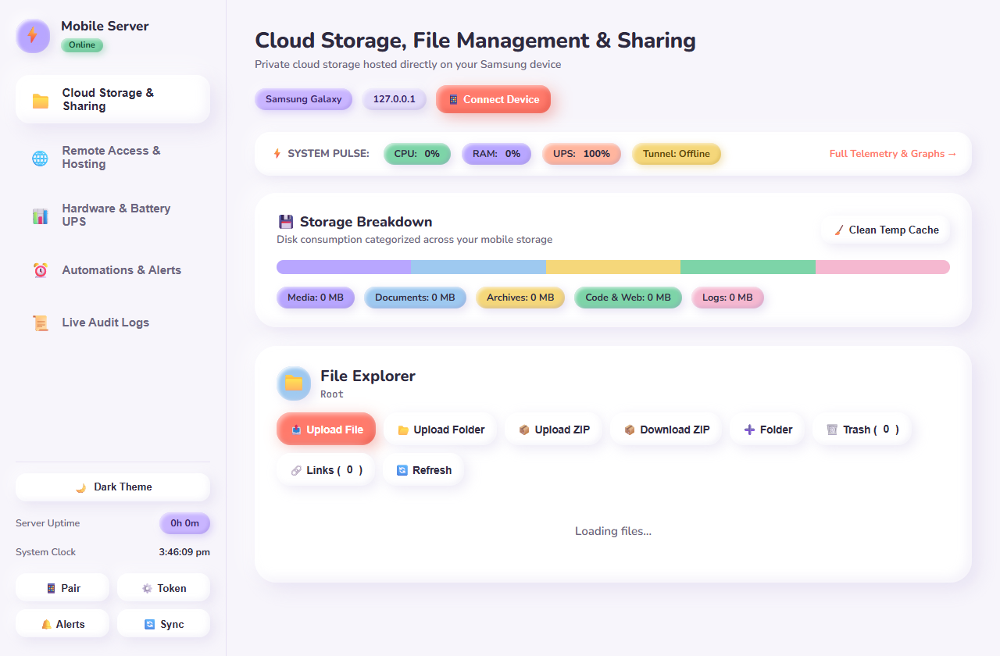
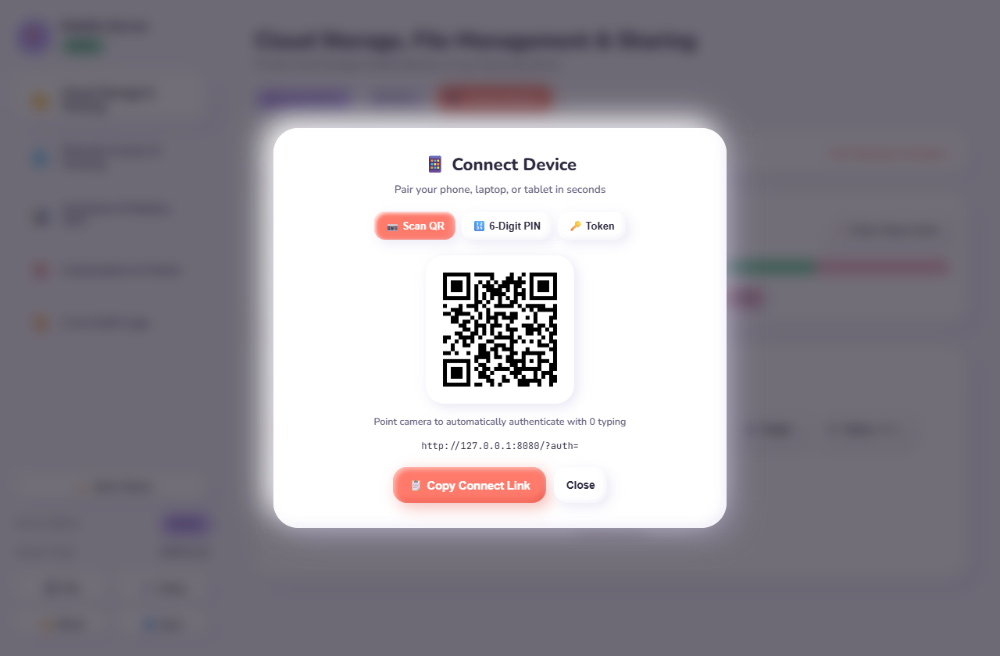
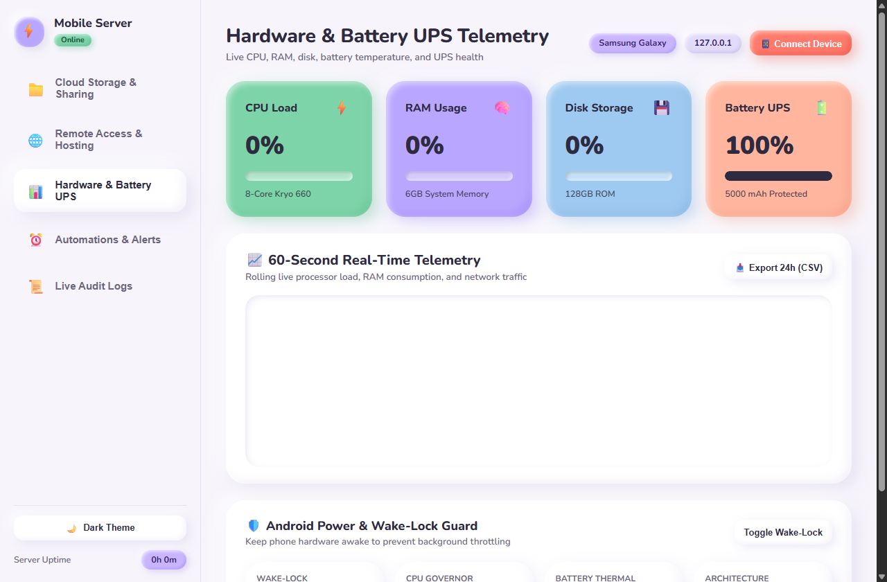
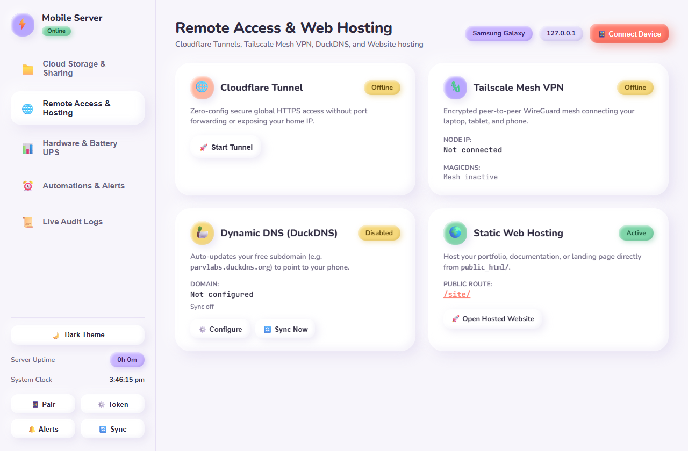
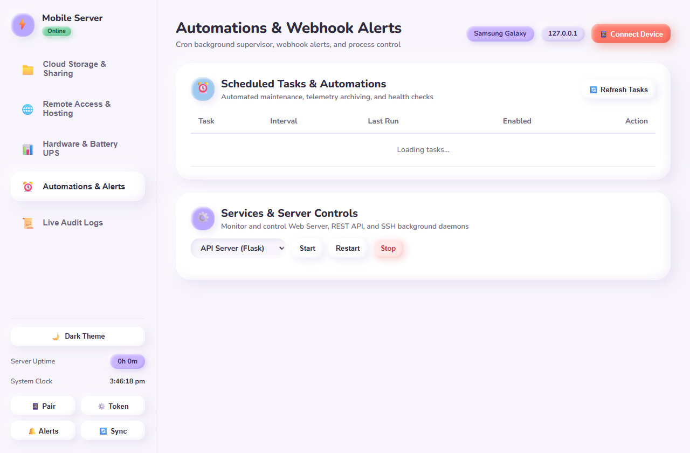

# ⚡ Mobile Hosted Server

> **Ultra low-power personal home server & private cloud for Android (Termux) and PC. Features real-time hardware telemetry, built-in battery UPS monitoring, web file manager with ZIP/folder uploads, zero-config Cloudflare tunnels, 1-tap QR connect, human-friendly 6-digit PIN pairing, and pure Claymorphism UI.**

[](https://www.python.org/)
[](https://flask.palletsprojects.com/)
[](https://termux.dev/)
[](CLAYMORPHISM.md)
[](LICENSE)

<p align="center">
  
</p>

An ultra-lightweight, self-hosted personal cloud and homelab server designed to run 24/7 on Android devices (via [Termux](https://termux.dev)) or on any desktop/laptop (Windows, Linux, macOS).

---

## 🌟 Why an Android Phone as a Server?

* 🔋 **Built-in Battery UPS**: Immune to sudden power outages — the phone's internal battery acts as a natural uninterrupted power supply (UPS), keeping your homelab online 24/7.
* ⚡ **Ultra Low Power**: Consumes only ~2–4W under load compared to 60–100W+ for traditional desktop or rack servers, saving money and generating zero noise.
* 📶 **Always Connected**: Built-in Wi-Fi and mobile cellular failover in a compact, fanless, pocket-sized footprint.
* ♻️ **Upcycle Old Hardware**: Turn spare smartphones into high-performance personal cloud storage and compute servers.

---

## 📸 Interface Tour & Feature Showcase

### 📁 1. Cloud Storage, File Management & Sharing
The primary landing view gives you full control over your storage. Upload individual files, nested folder structures, or `.zip` archives with automatic extraction. Preview photos, stream media, edit code in-browser, and monitor storage breakdown by category.

<p align="center">
  
</p>

---

### 📱 2. 1-Tap QR Connect & 6-Digit PIN Pairing
Pair any phone, laptop, or tablet in seconds with zero friction. Point your camera at the dynamic QR code to open the dashboard with instant authentication, or enter the human-friendly 6-digit PIN (`199 593`) without typing 32-character tokens.

<p align="center">
  
</p>

---

### 📊 3. Real-Time Hardware Telemetry & Battery UPS Health
A smooth 60-second canvas graph tracks CPU %, RAM %, and network bandwidth in real time. Continuous battery level and thermal monitoring guard your phone from swelling with smart charging advisories during 24/7 wall power.

<p align="center">
  
</p>

---

### 🌐 4. Remote Access & Public Web Hosting
Expose your server globally with zero port forwarding via 1-click Cloudflare Tunnels, join private WireGuard networks with Tailscale Mesh VPN, auto-update DuckDNS dynamic DNS records, and host static websites directly from `public_html/`.

<p align="center">
  
</p>

---

### ⏰ 5. Background Automations, Cron Tasks & Webhook Alerts
An automated recurring background supervisor handles shared storage backups, cache pruning, and log rotation. Push notifications alert your Discord channel or Telegram bot on critical hardware triggers (high temperature, low battery, low disk).

<p align="center">
  
</p>

---

## ✨ Core Features Breakdown

### 🎨 Pure Claymorphism UI & Micro-Interactions
* 🏺 **Spec-Compliant Claymorphism**: Built following the official spec verbatim — multi-layer colored depth and drop shadows, top-left specular sheens, 28px chunky radii, and tactile squish on click (`scale(0.97)`).
* ⚡ **Tactile Soft Pop-Up & Subtle Glow**: Interactive micro-elevation (`translateY(-2px) scale(1.025)`) and ambient glow across all chips, status pills, buttons, squircle icon tiles, and navigation items.
* 📱 **Dedicated Left Sidebar**: Clean navigation between **Cloud Storage & Sharing**, **Remote Access & Hosting**, **Hardware & Battery UPS**, **Automations & Alerts**, and **Live Audit Logs**.
* ⚡ **Quick System Pulse Bar**: Real-time status chips on the landing page for CPU, RAM, Battery UPS, and Tunnel connectivity with 1-click jumps to detailed telemetry.

### 📁 Cloud Storage & File Manager
* 📦 **ZIP Upload & Auto-Extraction**: Upload `.zip` archives with 1-click automatic unpacking or store archives as-is.
* 📂 **Folder Uploads & ZIP Downloads**: Upload entire directory trees from your browser, or download any folder bundled into a `.zip` file.
* 📝 **In-Browser Text & Code Editor**: Edit `.txt`, `.py`, `.sh`, `.json`, `.md`, `.html`, `.css`, and `.yaml` files with `Ctrl+S` quick save.
* 🔗 **Expiring Public Share Links**: Create shareable links with custom expiration (1 hour to 7 days), download caps, and optional password protection.
* 🗑️ **Safe Trash Bin**: Files are moved to `.trash/` instead of being permanently lost, with 1-click restore.
* 🔍 **Interactive Category Filtering**: Click any storage category pill (`Media`, `Documents`, `Archives`, `Code & Web`, `Logs`) to instantly filter files in the directory.
* 🎬 **In-line Media Streaming**: Stream audio/video and preview photos directly in the browser.

### 🌐 Remote Access & Public Hosting
* 🌐 **1-Click Cloudflare Tunnel**: Expose your mobile server globally over HTTPS with zero port forwarding, no router access, and hidden home IP.
* 🦎 **Tailscale Mesh VPN**: Private, end-to-end encrypted WireGuard network connecting your phone server directly to your personal devices.
* 🦆 **DuckDNS Dynamic DNS Auto-Updater**: Background daemon syncing dynamic IP addresses to free `*.duckdns.org` subdomains.
* 🌍 **Static Website Hosting**: Host documentation, portfolios, or landing pages directly out of `public_html/` at `/site/`.

### 📊 Real-Time Telemetry & Hardware Protection
* 📈 **60-Second Real-Time Graph**: Live canvas rendering CPU load %, RAM usage %, and network bandwidth.
* 📥 **24-Hour Metrics Export**: Background telemetry logger with CSV/JSON export.
* 🛡️ **Battery Thermal & Swelling Guard**: Molded cream clay alert banner warning of continuous high-temperature charging to preserve battery longevity.
* 🔒 **Android Wake-Lock & Governor**: Real-time CPU governor stats and 1-click Termux wake-lock to prevent OS hibernation.

### ⏰ Automations & Webhook Alerts
* ⏰ **Scheduled Cron Supervisor**: Recurring background jobs for backups, temporary cache cleaning, and log rotation.
* 🔔 **Discord & Telegram Push Webhooks**: Instant notifications on critical events (battery temperature > 45°C, battery level < 15%, low disk space).
* 📜 **Live Audit Logs**: Real-time log streamer with auto-refresh and secure 1-click clearing.
* ⚙️ **Services Grid**: Start, stop, and restart controls for Web, API, and SSH services.

---

## 🚀 Quick Start

### 📱 Running on Android (Termux)

1. **Install Termux and Termux:API** from [F-Droid](https://f-droid.org/en/packages/com.termux/).
2. **Open Termux** and install required packages:
   ```bash
   pkg update -y
   pkg install -y python git termux-api
   ```
3. **Clone the repository**:
   ```bash
   git clone https://github.com/parvlabs/mobile-hosted-server.git ~/server
   cd ~/server
   ```
4. **Install Python dependencies**:
   ```bash
   pip install -r requirements.txt
   ```
5. **Start all services**:
   ```bash
   bash start-all.sh
   ```
6. **Open the Dashboard**:
   The terminal will display your local IP and 6-digit pair PIN. Open your browser on any device on the same Wi-Fi:
   ```text
   http://<PHONE_IP>:8080
   ```

---

### 💻 Running Locally on Windows / macOS / Linux

1. **Clone the repository**:
   ```bash
   git clone https://github.com/parvlabs/mobile-hosted-server.git
   cd mobile-hosted-server
   ```
2. **Install dependencies**:
   ```bash
   pip install -r requirements.txt
   ```
3. **Launch the server**:
   * **Windows (One-Click)**: Double-click `start-local.bat`
   * **Terminal (Any OS)**:
     ```bash
     python run_local.py
     ```
   The runner starts both the Flask API (`:5000`) and the Dashboard (`:8080`), displays your 6-digit PIN and security token, and automatically launches the dashboard in your default browser.

---

## 📂 Project Structure

```text
mobile-hosted-server/
├── api.py              # Flask backend REST API (telemetry, storage, services, logs, cron, DDNS, PIN auth)
├── index.html          # Claymorphism frontend dashboard (sidebar, file explorer, telemetry chart, modals)
├── public_html/        # Hosted static website directory served at /site/
├── docs/
│   └── screenshots/    # High-resolution UI showcase screenshots
├── run_local.py        # Cross-platform runner for Windows / macOS / Linux
├── start-local.bat     # One-click Windows batch launcher
├── start-all.sh        # Background launcher for Termux / Linux
├── start-api.sh        # Foreground API debug launcher
├── start-dashboard.sh  # Foreground HTTP server debug launcher
├── start-server.sh     # Boot script for Termux:Boot app
├── requirements.txt    # Python dependencies
├── .gitignore          # Security rules (ignores tokens, pins, logs, uploaded files)
└── README.md           # Documentation & visual showcase
```

---

## 🔒 Security Model

* **Sandboxed Storage**: File Manager access is strictly confined to `~/server/shared/`. Path traversal (`../`, absolute paths, symlinks) is blocked via sanitized path resolution.
* **PIN & Token Authentication**: Modifying files, server controls, and logs require valid authorization (`API_TOKEN` or 6-digit `API_PIN`). Tokens are cryptographically generated in `.token` and PINs in `.pin`.
* **Private Network First**: Localhost and local private network subnets (10.x, 172.16-31.x, 192.168.x) are supported with timing-safe token verification (`secrets.compare_digest`).
* **Safe Error Handling**: Unhandled exceptions return sanitized JSON responses without leaking Python tracebacks.

---

## 📜 License

This project is licensed under the [MIT License](LICENSE).
